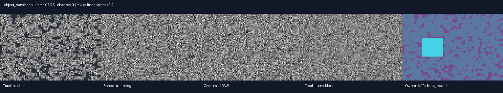
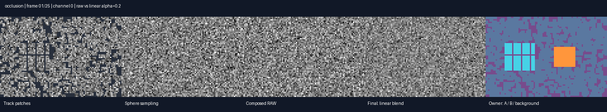
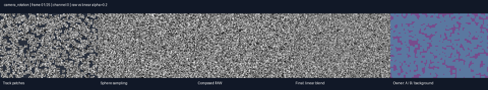
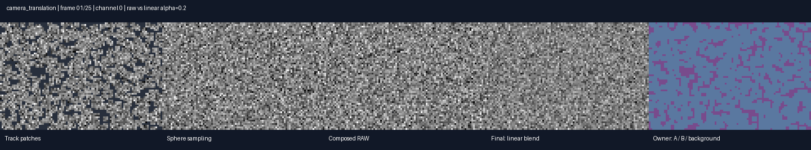
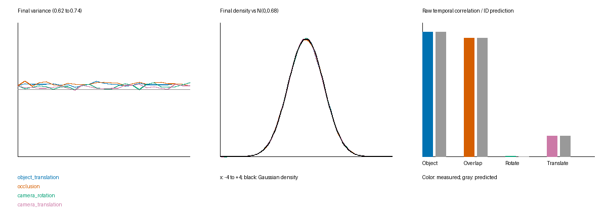

<div align="center">

# [Unofficial] Track the Noise, Move the World

### 3D-Grounded Motion-Consistent Noise for Controllable Video Generation

Independent UniCaMo noise construction · Synthetic scenes · Reproducible statistics

[](README.md) [](README_zh.md) [](https://arxiv.org/abs/2607.02798v1) [](docs/PAPER_AUDIT.md) [](results/REPORT.md)

</div>

---

A small, CPU-ready implementation of the **structured noise construction** in UniCaMo. Explore object motion, depth ordering, and changing camera views with inspectable noise sources and recorded statistics.

> **Scope:** Independent implementation of the paper’s noise module. Wan integration and LoRA training are outside this repository. Ambiguous paper details are documented in the [implementation audit](docs/PAPER_AUDIT.md).

[**Explore the demos ↓**](#motion-gallery) · [**Run locally ↓**](#quick-start) · [**Use your own inputs ↓**](#bring-your-own-tracks)

## Motion gallery

Every animation shows the same five stages, from geometric guidance to the final noise:

**Track patches → Sphere samples → Composed raw noise → Final blended noise → Ownership**

Cyan and orange mark foreground groups; blue-gray marks background tracks; purple marks untracked first-frame reference noise. The previews use a fixed grayscale range; statistics use the original floating-point values.

#### Object translation



#### Occlusion & depth-order swaps



<details>
<summary><b>Camera rotation</b></summary>



</details>

<details>
<summary><b>Camera translation</b></summary>



</details>
## Quick start

**Python 3.9+ · CPU · NumPy + Pillow**

**1. Set up the environment**

```sh
git clone https://github.com/gulucaptain/UniCaMo-Implementation.git
cd UniCaMo-Implementation
python3 -m venv .venv
source .venv/bin/activate
python -m pip install -r requirements.txt
```

**2. Test and reproduce the results**

```sh
python -m unittest discover -s tests -v
python examples/run_synthetic.py
```

The script regenerates all four scenes, 20 independent occlusion seeds, first-frame policy comparisons, and sphere-only diagnostics. Outputs replace the matching files in `results/`. Allow a few hundred MB of available memory.

<details>
<summary><b>Generated files & environment notes</b></summary>

| Output | Contents |
| :--- | :--- |
| `*.gif` / `*.png` | Animations and static previews |
| `*.npz` | Full noise arrays, geometry, provenance, and configuration; about 28 MB per scene |
| `statistics.json` | Moments, spatial/temporal correlations, and sensitivity checks |
| `ensemble_samples.json` | Individual measurements for all 20 seeds |
| `validation.json` | Source identity and copy-error checks |
| `manifest.json` | Runtime versions and source hashes |
| `REPORT.md` | Experiment summary |

Seeds are fixed. Numerical and image-encoding details can differ across dependency versions; the manifest records the environment. To import from outside this checkout, run `python -m pip install -e .`.

</details>

## How the noise is built

| Stage | Operation | What it encodes |
| :--- | :--- | :--- |
| **Track-the-Noise** | Project 3D tracks; copy immutable first-frame 3×3 patches | Local motion |
| **Depth selection** | Keep the nearest positive camera-depth contribution at overlaps | Occlusion ordering |
| **Move-the-World** | Cast rays into a shared Gaussian sphere texture | View-dependent noise correspondence |
| **Composition** | Keep track patches; fill uncovered regions from the sphere | A complete noise sequence |
| **Degradation** | Apply the documented linear alpha-blending interpretation | Additional independent noise |

Object tracks and camera parameters are separate inputs. A moving 3D point changes its image projection even under a fixed camera, so its noise patch moves while the sphere samples remain stationary.

## Measured, not just visualized

| Checks | Recorded result |
| :--- | :--- |
| Geometry, copying, visibility, and blending | **10 tests passed** |
| Raw noise from identical source IDs | **Exactly identical** |
| Maximum copy error | **0** |
| Mean final variance over 20 occlusion seeds | **0.68034 ± 0.00191** (between-seed standard deviation) |

The default interpretation is `0.8 × raw + 0.2 × iid`, with theoretical marginal variance **0.68**. No variance renormalization is applied. Source reuse predicts correlations; samples across pixels and frames are not assumed independent.

| Scene | Raw variance | Final variance | Raw temporal correlation | Source-ID prediction |
| :--- | ---: | ---: | ---: | ---: |
| Object translation | 1.0075 | 0.6846 | 0.9304 | 0.9302 |
| Occlusion | 1.0088 | 0.6854 | 0.8856 | 0.8842 |
| Camera rotation | 1.0048 | 0.6830 | 0.0002 | 0.0000 |
| Camera translation | 1.0037 | 0.6824 | 0.1520 | 0.1516 |



<details>
<summary><b>Experiment settings & loading the arrays</b></summary>

| Setting | Value |
| :--- | :--- |
| Sequence | 25 noise frames · 16 channels |
| Guidance | 1,024 tracks per main scene |
| Image / noise grid | 128×192 / 64×96 |
| Sphere texture | 512×768; image dimensions ×4 |
| Random seed | 42 for the four main scenes |
| Geometry | Synthetic foregrounds and a static background plane |

These sizes are demo settings, not Wan VAE settings. Foreground counts and trajectories are test fixtures, not the paper’s mask GUI or learned geometry pipeline.

```python
import numpy as np

with np.load('results/occlusion.npz', allow_pickle=False) as data:
    noise = data['noise']    # [T, H_lat, W_lat, C], float32
    tracks = data['tracks']  # [T, N, 3], world coordinates
```

Each NPZ also stores raw noise, sphere samples, the initial reference, source IDs, ownership, coverage, depth, projections, camera parameters, visibility, and configuration.

</details>

[**Full experiment report →**](results/REPORT.md)

## Bring your own tracks

```python
import numpy as np
from unicamo_noise import construct_noise

with np.load('guidance.npz', allow_pickle=False) as guidance:
    result = construct_noise(
        guidance['tracks'],       # [T,N,3], world coordinates
        guidance['intrinsics'],   # [T,3,3], IMAGE pixel units
        guidance['w2c'],          # [T,4,4], world-to-camera
        visibility=guidance['visibility'],  # [T,N], boolean
        height=64, width=96, channels=16,
        image_height=128, image_width=192,
        depth_bound=8.,           # replace with YOUR first-frame maximum depth
        sphere_downsample='nearest',
        first_frame_policy='preserve_reference',
        degradation=.2, blend='linear', seed=42,
    )
np.save('noise.npy', result['noise'])
```

Use right/down/forward camera axes and rigid extrinsics. All geometry must share a coordinate system and depth scale. Choose image/grid sizes to match your input; the values above are demo settings and do not define Wan's VAE compression. Visibility defaults to true when omitted; the module does not compute dense surface visibility.

## Implementation fidelity

The [paper audit](docs/PAPER_AUDIT.md) maps each operation to the main text and appendices, distinguishing explicit requirements from implementation choices.

<details>
<summary><b>Read the unresolved choices and reproduction boundaries</b></summary>

Read [PAPER_AUDIT.md](docs/PAPER_AUDIT.md) for the section-by-section mapping to §3.1–3.3, §4.3, Appendix A, and Appendix B.3.

- Explicitly specified operations follow the paper: first-frame patch copying, depth selection, sphere center/radius, UV equations, nearest texture sampling, track-priority composition, R=2, k=4, and default degradation 0.2.
- **The exact degradation formula is unspecified.** This implementation uses ordinary linear alpha blending, without variance renormalization; this is an interpretation, not an author-confirmed formula. No square-root-weight variance-preserving improvement is silently applied.
- **Image-to-latent downsampling and first-frame composition are unspecified.** Callers must explicitly select the implemented nearest downsampling and either `preserve_reference` or `compose` first-frame policy. Both policies are examined in the recorded diagnostics.
- Reference and environment noise are independently sampled; source coupling is unspecified. Pixel rounding, patch boundary handling, visibility filtering, and equal-depth tie-breaking are documented implementation choices.
- Time steps map one-to-one to noise frames. VAE temporal compression is outside this module.

These tests establish consistency with the documented interpretation. They do not establish equivalence to the authors' code, improvement over Go-with-the-Flow, or downstream video quality.

</details>

## Project structure

```text
unicamo_noise/core.py       Noise construction and geometric sampling
examples/run_synthetic.py  Deterministic demos, statistics, and reports
tests/                     Geometry, copying, visibility, and statistics tests
docs/PAPER_AUDIT.md         Explicit paper requirements versus interpretations
results/                   GIFs, PNGs, NPZ arrays, JSON metrics, and report
```

## Citation

```bibtex
@misc{vu2026tracknoise,
  title         = {Track the Noise, Move the World: 3D-Grounded Motion-Consistent Noise for Controllable Video Generation},
  author        = {Long Vu and Tan Ngo and Animesh Karnewar and Amir Habibian and Binh-Son Hua and Hung Bui and Minh Hoai Nguyen and Phong Nguyen-Ha},
  year          = {2026},
  eprint        = {2607.02798},
  archivePrefix = {arXiv},
  primaryClass  = {cs.CV},
  url           = {https://arxiv.org/abs/2607.02798v1}
}
```
